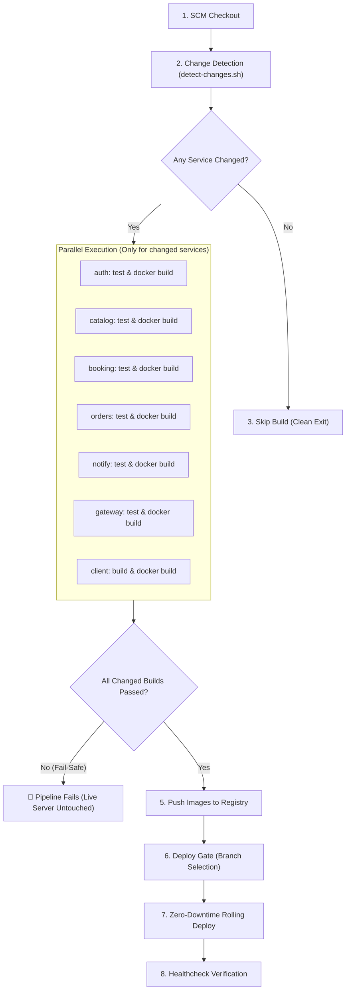

# OrderFirst Jenkins CI/CD Pipeline Design

**Date:** 2026-11-08  
**Status:** Approved  
**Author:** Pair Programming Agent & User  

---

## 1. Overview & Objectives

OrderFirst is a monorepo consisting of 6 backend TypeScript microservices (`auth`, `catalog`, `booking`, `orders`, `notify`, `gateway`), 1 frontend client application (`client`), and shared database migration scripts (`db-migrate`).

The goal of this design is to create a robust, maintainable Jenkins CI/CD pipeline centralized in `deploy/jenkins/` with:
- **Selective Change Detection**: Only tests, builds, and deploys services that have actual code changes in the given commit or pull request.
- **Fail-Safe Quality Gates**: Any test or build failure immediately halts the pipeline without touching live running services.
- **Zero-Downtime Deployment**: Updates only modified containers using `docker compose -f deploy/compose/docker-compose.<env>.yml up -d --no-deps <service>`, leaving untouched services online and serving user requests.
- **Strict Centralization**: All CI/CD scripts and pipeline definitions reside exclusively in `deploy/jenkins/`.

---

## 2. Architecture & File Placement

All CI/CD assets are organized under `deploy/jenkins/`:

```
deploy/jenkins/
├── Jenkinsfile                    # Unified declarative Jenkins pipeline
└── scripts/
    ├── detect-changes.sh          # Git diff analyzer determining changed services
    └── deploy.sh                  # Zero-downtime compose deployment orchestrator
```

---

## 3. Pipeline Flow & Stages



### Stage Details

1. **Stage: Change Detection**
   - Script: `deploy/jenkins/scripts/detect-changes.sh`
   - Compares `HEAD` against previous commit or target branch (`git diff --name-only`).
   - If changes touch `services/<name>/`, flag `BUILD_<NAME>=true`.
   - If changes touch `infra/`, `deploy/compose/`, or root package manifests, all flags set to `true`.
   - Exports environment variables for downstream Jenkins stages.

2. **Stage: Parallel Quality Gate & Build**
   - Declarative parallel branches execute concurrently for each service marked `true`:
     - Run lint / typecheck (`tsc --noEmit`).
     - Run unit tests (`npm test`).
     - Build Docker image: `docker build -t $REGISTRY/$SERVICE:$IMAGE_TAG -f services/$SERVICE/Dockerfile .`
   - **Fail-Fast**: If any branch throws an error, Jenkins cancels downstream deployment immediately.

3. **Stage: Registry Push**
   - Uses Jenkins credentials ID `docker-registry-credentials`.
   - Pushes images tagged with `:commit-${GIT_COMMIT_SHORT}` and `:latest`.

4. **Stage: Deployment**
   - Branch mapping:
     - `main` / `master` &rarr; Production (`.env.prod` + `deploy/compose/docker-compose.prod.yml`).
     - `develop` / `stage` &rarr; Development (`.env.dev` + `deploy/compose/docker-compose.dev.yml`).
   - Executes targeted service reload:
     ```bash
     docker compose -f deploy/compose/docker-compose.<env>.yml up -d --no-deps <changed-services>
     ```
   - Only the updated container is recreated; all other services, PostgreSQL, and RabbitMQ continue running without interruption.

5. **Stage: Healthcheck & Verification**
   - Validates that the Gateway and updated services respond healthy (`curl -f http://localhost:4000/health`).
   - If healthcheck fails, pipeline alerts and flags the deployment for investigation.

---

## 4. Error Handling & Blast Radius Protection

| Scenario | Behavior | Live Production Impact |
| :--- | :--- | :--- |
| **A service fails unit tests** | Pipeline stops at Stage 2. Deploy stage does not execute. | **Zero impact.** Live containers continue running previous healthy code. |
| **A service Dockerfile build fails** | Pipeline stops at Stage 2. Deploy stage does not execute. | **Zero impact.** Live containers continue running previous healthy code. |
| **Only `auth` is modified and succeeds** | Only `auth` container is recreated via `--no-deps auth`. | **Zero impact** on `orders`, `catalog`, `booking`, `notify`, `gateway`, or `client`. |
| **Database migration needed** | If `infra/postgres` or Prisma schemas changed, `db-migrate` runs before service restart. | Migrations apply forward compatibly. |

---

## 5. Jenkins Prerequisites & Configuration

- **Plugins**: Pipeline, Git, Docker Pipeline, Credentials Binding.
- **Credentials**:
  - `docker-registry-credentials` (Username/Password or Token for Docker Hub / AWS ECR / Private Registry).
  - Optional `deploy-ssh-key` if Jenkins deploys to a remote server rather than the local host.
- **Agent Environment**: Docker CLI and Node.js 22 installed on the Jenkins agent.
